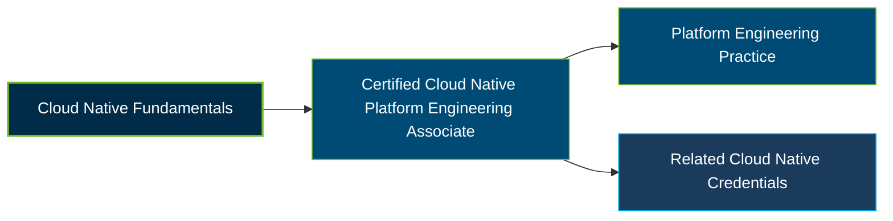

# Linux Foundation Certified Cloud Native Platform Engineering Associate (CNPA) Certification Exam Guide

A dedicated, comprehensive study guide and cloud-native platform engineering reference repository for candidates preparing for the **Linux Foundation Certified Cloud Native Platform Engineering Associate (CNPA) Certification Exam**.

---

## Exam Overview

The Certified Cloud Native Platform Engineering Associate certification validates foundational knowledge of platform engineering, self-service infrastructure, automation, and developer-focused cloud-native platforms.

- **Exam Format**: Online, proctored, multiple-choice exam
- **Target Audience**: Platform engineers, cloud engineers, DevOps professionals, and software engineers
- **Prerequisites**: None

---

## Core Exam Domains & Knowledge Areas

### 1. Platform Engineering Core Fundamentals

- Declarative resource management, infrastructure concepts, and platform architecture.
- DevOps practices, continuous integration, continuous delivery, and GitOps.
- Platform engineering goals, capabilities, and implementation approaches.

### 2. Platform Observability, Security, and Conformance

- Observability fundamentals, including traces, metrics, logs, and events.
- Secure service communication and Kubernetes security essentials.
- Policy engines for platform governance and security in CI/CD pipelines.

### 3. Continuous Delivery & Platform Engineering

- Continuous integration pipelines and CI/CD relationships.
- GitOps fundamentals, workflows, and application environments.
- Incident response practices in platform engineering.

### 4. Platform APIs and Provisioning Infrastructure

- Kubernetes reconciliation loops and declarative resource management.
- Custom Resource Definitions (CRDs) for self-service platform APIs.
- Infrastructure provisioning and the Kubernetes Operator pattern.

### 5. IDPs and Developer Experience

- Self-service access to internal platform capabilities.
- API-driven service catalogs and developer portals.
- Developer experience and AI/ML in platform automation.

### 6. Measuring Your Platform

- Platform efficiency and team productivity.
- DORA metrics for assessing platform initiatives.

---

## Certification Path

This is a suggested learning progression, not an official prerequisite or mandatory certification pathway. The Linux Foundation also identifies KCNA, KCSA, CBA, and OTCA as credentials that pair well with CNPA.

---

## Recommended Practice & Study Resources

Combine official certification materials with practical study of cloud-native platforms, infrastructure automation, and developer experience.

- **Official Linux Foundation Resources**: Review the [CNPA certification page](https://training.linuxfoundation.org/certification/certified-cloud-native-platform-engineering-associate-cnpa/) and the [official CNCF CNPA curriculum](https://github.com/cncf/curriculum/blob/master/CNPA_Curriculum.pdf).
- **CertsGate**: Explore [CNPA certification preparation resources](https://certsgate.com/exams/linux-foundation/cnpa) for supplementary study materials and practice questions.
- **Practical Platform Engineering Study**: Read the [CNCF Platforms White Paper](https://tag-app-delivery.cncf.io/whitepapers/platforms/) to understand internal developer platforms, self-service capabilities, platform architecture, and developer experience.
